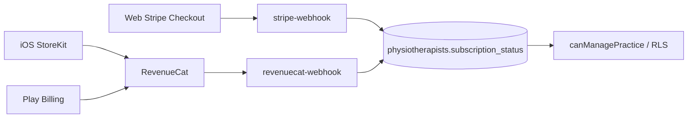

# Etapa 3 — Billing Opção B (RevenueCat + Stripe)

**Decisão:** StoreKit + Google Play via **RevenueCat**; Stripe permanece no site.

## Fonte única de entitlement

| Campo | Papel |
|-------|--------|
| `physiotherapists.subscription_status` | `trialing` \| `active` \| `inactive` — **única** porta de acesso |
| `trial_ends_at` | Só relevante se `trialing` |
| `billing_provider` | `stripe` \| `revenuecat` \| null — quem “possui” a assinatura ativa |
| `stripe_*` | IDs Stripe (web) |
| `revenuecat_app_user_id` | App User ID no RC (= `profiles.id` / auth uid) |

`canManagePractice` e RLS (`private.physio_has_active_subscription`) **não mudam a regra** — só leem `subscription_status` + `trial_ends_at`.

## Anti-duplicação

1. **Ativação:** se já há entitlement de **outro** provider, o webhook **não** troca o `billing_provider` (mantém o dono atual; acesso continua ativo).
2. **Expiração/cancelamento:** só aplica `inactive` se o evento for do **mesmo** `billing_provider` (ou se provider ainda for null).
3. **UI web:** se `billing_provider = revenuecat`, esconde Stripe checkout/portal e orienta gerenciar na loja.
4. **UI native:** se `billing_provider = stripe`, esconde compra IAP e orienta gerenciar no site; permite restore RC.
5. Pacotes/sessões de paciente continuam **somente Stripe** (serviço real).

## Fluxos

| Canal | Aquisição | Renovação / portal |
|-------|-----------|-------------------|
| Web | Stripe Checkout (`/assinar`, `/physio/assinatura`) | Customer Portal |
| iOS/Android | RevenueCat `purchasePackage` (entitlement `fisionotes_pro`) | Conta Apple/Google + restore |

`app_user_id` RevenueCat = UUID do usuário Supabase Auth.

## Secrets / env

| Variável | Onde |
|----------|------|
| `STRIPE_*` | Edge (já existe) |
| `REVENUECAT_WEBHOOK_SECRET` | Edge `revenuecat-webhook` Authorization bearer |
| `VITE_REVENUECAT_IOS_API_KEY` | Client Capacitor (public SDK key) |
| `VITE_REVENUECAT_ANDROID_API_KEY` | Client Capacitor (public SDK key) |
| `VITE_REVENUECAT_ENTITLEMENT_ID` | Default `fisionotes_pro` |

## Dashboard RevenueCat (você configura)

1. Apps iOS + Android com Bundle ID `br.com.fisionotes.app`
2. Product / Offering alinhados a R$ 29,90/mês + trial 7 dias nas lojas
3. Entitlement id: `fisionotes_pro`
4. Webhook → `https://<project>.supabase.co/functions/v1/revenuecat-webhook` com secret

## Implementado no código

| Peça | Local |
|------|--------|
| Colunas `billing_provider`, `revenuecat_app_user_id` | `supabase/migrations/024_revenuecat_billing_provider.sql` |
| Merge anti-duplicação | `supabase/functions/_shared/saas-entitlement.ts` (+ espelho em `src/.../saas-entitlement.ts`) |
| Webhook RC | `supabase/functions/revenuecat-webhook` |
| Stripe webhook seta `billing_provider=stripe` | `supabase/functions/stripe-webhook` |
| SDK Capacitor | `src/shared/native/revenuecat.ts` |
| UI gates | `src/pages/physio/subscription-page.tsx` |
| `/assinar` no native | redireciona ao login (criação de conta permanece no site) |

## Fora do escopo desta etapa

- Remover Stripe
- IAP para pacotes de paciente
- Publicar nas lojas / Codemagic
- Provisionar conta nova só via IAP (v1 exige conta já existente / site)
